Activation functions introduce non-linearities into neural networks, enabling them to approximate complex, non-linear functions (Universal Approximation Theorem). Without non-linear activations, stacking linear layers $W_2(W_1 x + b_1) + b_2$ collapses mathematically into a single linear transformation $(W_2 W_1)x + (W_2 b_1 + b_2)$.

## 1\. Classical Sigmoidal Activations

These squash inputs into a bounded range. While historically popular, they suffer from severe gradient saturation in deep networks.

### Sigmoid (Logistic)

Maps real-valued inputs into the range $(0, 1)$:

$$
\sigma(x) = \frac{1}{1 + e^{-x}}, \quad \sigma'(x) = \sigma(x)(1 - \sigma(x))
$$

- **Properties:** Outputs are strictly positive, differentiable everywhere, and naturally represent probabilities.
- **Limitations:**
	- **Vanishing Gradients:** Maximum derivative occurs at $x = 0$ where $\sigma'(0) = 0.25$. As $\vert{}x\vert{}$ grows, $\sigma'(x) \to 0$. Multiplying many factors $\le 0.25$ down dozens of layers drives backpropagated gradients to zero.
		- **Non-Zero-Centered:** Since outputs are strictly positive, gradients on incoming weights $w$ in $\frac{\partial L}{\partial w} = \frac{\partial L}{\partial z} \cdot x$ all take the same sign as $\frac{\partial L}{\partial z}$, causing zig-zagging gradient dynamics during optimization.
- **Modern Role:** Rarely used in hidden layers; standard for binary classification output heads and gating mechanisms (e.g., LSTMs, GRUs, GLUs).
- 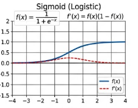

### Hyperbolic Tangent ($\tanh$)

A zero-centered, rescaled variant of the sigmoid squashing inputs into $(-1, 1)$:

$$
\tanh(x) = \frac{e^x - e^{-x}}{e^x + e^{-x}} = 2\sigma(2x) - 1, \quad \tanh'(x) = 1 - \tanh^2(x)
$$

- **Properties:** Zero-centered output prevents the systematic directional bias seen in Sigmoid; maximum derivative is $\tanh'(0) = 1.0$.
- **Limitations:** Still saturates quickly when $\vert{}x\vert{} > 2$, triggering vanishing gradients in deep feedforward or recurrent chains.
- **Modern Role:** Hidden states in classical RNNs/LSTMs, diffusion model conditioning latents, and value-head bounding.
- 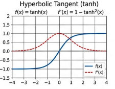

## 2\. Rectified Linear Family

Introduced to overcome vanishing gradients for positive inputs by maintaining a constant unit derivative.

### ReLU (Rectified Linear Unit)

The workhorse non-linearity for computer vision and classic multi-layer perceptrons:

$$
\text{ReLU}(x) = \max(0, x), \quad \frac{d}{dx}\text{ReLU}(x) = \begin{cases} 1 & \text{if } x > 0 \\ 0 & \text{if } x < 0 \end{cases}
$$

- **Strengths:**
	- Extreme computational efficiency (single comparison / bit-mask operation).
		- No saturation on the positive regime ($\text{gradient} = 1$), which fundamentally unlocked training of deep networks like AlexNet and ResNet.
		- Induces sparse representations by setting negative activations to zero.
- **Limitations:**
	- **Dying ReLU:** If a large gradient pushes weights such that a neuron outputs $x < 0$ across all training samples, its gradient remains permanently $0$. The neuron never updates again.
		- Not zero-centered.
- 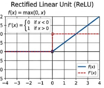

### Leaky ReLU

Fixes the "Dying ReLU" problem by assigning a small, fixed negative slope:

$$
\text{LeakyReLU}(x) = \max(\alpha x, x) \quad (\text{typically } \alpha = 0.01)
$$

- **Derivative:** $\alpha$ for $x < 0$; $1$ for $x > 0$. Ensures a small non-zero gradient flows through negative states, preventing dormant dead neurons.
- 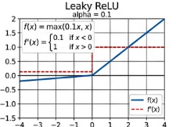

### PReLU (Parametric ReLU)

Promotes the negative slope $\alpha$ to a learnable parameter:

$$
\text{PReLU}(x) = \max(\alpha x, x)
$$

- **Mechanism:** $\alpha$ is trained alongside network weights via backpropagation (can be channel-shared or per-channel). If $\alpha = 0$, it behaves as ReLU; if $\alpha > 0$, it behaves as Leaky ReLU.
- 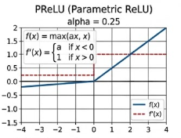

### ELU (Exponential Linear Unit)

Brings the mean activation closer to zero while smoothing the negative boundary:

$$
\text{ELU}(x) = \begin{cases} x & \text{if } x > 0 \\ \alpha(e^x - 1) & \text{if } x \le 0 \end{cases} \quad (\text{typically } \alpha = 1.0)
$$

- **Strengths:** Smoothly saturates to $-\alpha$ for large negative inputs, providing noise robustness while maintaining zero-mean centering.
- **Drawback:** Higher compute cost due to evaluating the transcendental exponential function $e^x$.
- 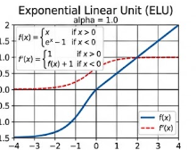

### SELU (Scaled Exponential Linear Unit)

A self-normalizing activation function that enforces activations to converge toward zero mean and unit variance across layers:

$$
\text{SELU}(x) = \lambda \begin{cases} x & \text{if } x > 0 \\ \alpha(e^x - 1) & \text{if } x \le 0 \end{cases}
$$

- Fixed constants derived using Banach fixed-point theorem: $\lambda \approx 1.0507$, $\alpha \approx 1.6733$.
- Eliminates the strict requirement for explicit Batch Normalization in deep feedforward networks, though fragile to dropout and specialized initializations.
- 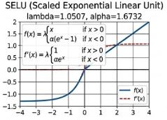

## 3\. Smooth & Probabilistic Activations (Modern LLM & Transformer Standard)

These replace the hard non-differentiable kink at $x = 0$ with smooth curves, empirically yielding better optimization landscapes and downstream perplexity in Transformers.

### Softplus

A smooth analytic approximation of ReLU:

$$
\text{Softplus}(x) = \ln(1 + e^x), \quad \frac{d}{dx}\text{Softplus}(x) = \sigma(x)
$$

- Differentiable everywhere with a smooth derivative equal to the logistic sigmoid.
- Commonly used to parameterize strictly positive parameters (variances $\sigma^2$ in VAEs, Gaussian processes).
- 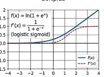

### GELU (Gaussian Error Linear Unit)

The standard activation function across early modern Transformers (BERT, GPT-2, GPT-3, ViT):

$$
\text{GELU}(x) = x \cdot \Phi(x) = x \cdot P(X \le x), \quad X \sim \mathcal{N}(0, 1)
$$

Using the standard normal CDF:

$$
\text{GELU}(x) = x \cdot \frac{1}{2} \left[1 + \text{erf}\left(\frac{x}{\sqrt{2}}\right)\right]
$$

Fast polynomial approximation:

$$
\text{GELU}(x) \approx 0.5x \left(1 + \tanh\left(\sqrt{\frac{2}{\pi}} \left(x + 0.044715 x^3\right)\right)\right)
$$

- **Intuition:** Combines regular deterministic activation with stochastic dropout. Instead of gating deterministically by sign ($\text{sign}(x)$ in ReLU), it gates inputs probabilistically based on how likely $x$ exceeds a standard normal distribution.
- **Key Feature:** Exhibits a smooth, non-monotonic dip into slightly negative values (minimum $\approx -0.17$ at $x \approx -0.75$), preventing hard zero boundaries.
- 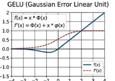

### SiLU / Swish

Independently discovered as **SiLU** (Sigmoid Linear Unit) and popularized as **Swish**:

$$
\text{SiLU}(x) = x \cdot \sigma(x) = \frac{x}{1 + e^{-x}}
$$

Parameterized Swish adds a scaling factor $\beta$: $\text{Swish}_\beta(x) = x \cdot \sigma(\beta x)$.

- When $\beta \to \infty$, Swish converges to ReLU; when $\beta = 0$, it becomes linear $\frac{x}{2}$.
- Like GELU, it is non-monotonic, smooth, and bounded below while unbounded above.
- Standard across modern diffusion backbones (Stable Diffusion, U-Nets) and LLM gated architectures.
- 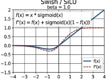

### Mish

A self-regularized smooth activation function:

$$
\text{Mish}(x) = x \cdot \tanh(\text{Softplus}(x)) = x \cdot \tanh(\ln(1 + e^x))
$$

- Similar profile to GELU and SiLU; popularized in computer vision architectures (YOLOv4) for improving gradient propagation across complex residual blocks.

- 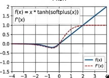

## 4\. Gated Activations in Large Language Models (GLU Family)

Modern open-weight and proprietary LLMs (Llama 2/3, Mistral, PaLM, Gemma, Qwen) do not apply isolated activation functions inside feedforward blocks. Instead, they use **Gated Linear Units (GLUs)**, splitting linear projections into two paths and multiplying one elementwise by an activated gate.

### Standard GLU

$$
\text{GLU}(x, W, V, b, c) = (xW + b) \otimes \sigma(xV + c)
$$

where $\otimes$ denotes elementwise (Hadamard) multiplication. One branch computes a linear representation, while the other serves as a sigmoid controller.

### SwiGLU & GeGLU

Proposed by Noam Shazeer (2020), replacing the outer sigmoid with smooth activations:

$$
\text{SwiGLU}(x) = \Big(\text{SiLU}(x W_{\text{gate}}) \otimes (x W_{\text{up}})\Big) W_{\text{down}}
$$

$$
\text{GeGLU}(x) = \Big(\text{GELU}(x W_{\text{gate}}) \otimes (x W_{\text{up}})\Big) W_{\text{down}}
$$

- **Why SwiGLU Dominates LLMs:**
	- **Multiplicative Interactions:** The elementwise product creates bilinear interactions between features, drastically increasing the expressive capacity of the MLP block without adding sequential layer depth.
		- **Gradient Routing:** The derivative of $(f(u) \cdot v)$ routes gradients through both paths simultaneously:
		$$
		\nabla_x = \nabla f(u) \cdot v + f(u) \cdot \nabla v
		$$
		Even if one path saturates, the other can pass gradients freely.
		- Standard MLP hidden dimensions in Transformers are typically $4d_{\text{model}}$; SwiGLU implementations typically downscale the intermediate dimension to $\frac{8}{3}d_{\text{model}}$ to maintain equivalent FLOPs and parameter counts while delivering lower perplexity.

## 5\. Multi-Class Normalization Activations

Applied across vector spaces rather than elementwise scalar inputs.

### Softmax

Converts an unconstrained vector of real-valued logits $z \in \mathbb{R}^K$ into a valid categorical probability distribution:

$$
\text{Softmax}(z)_i = \frac{e^{z_i / \tau}}{\sum_{j=1}^K e^{z_j / \tau}}
$$

- $\tau$ is a temperature hyperparameter ($\tau = 1.0$ standard; $\tau < 1$ sharpens toward $\arg\max$; $\tau > 1$ softens toward uniform distribution).
- Standard across attention score normalization ($\text{Softmax}(QK^T / \sqrt{d_k})$) and token generation heads.

### Sparsemax

Replaces the exponential function in Softmax with an Euclidean projection onto the probability simplex:

$$
\text{Sparsemax}(z) = \arg\min_{p \in \Delta^{K-1}} \Vert{}p - z\Vert{}^2
$$

- Unlike Softmax (which assigns strictly non-zero probability to all elements), Sparsemax truncates low logits to exact zeros, producing true sparse distributions for interpretable attention mechanisms.

## Architectural Summary Reference

| Activation        | Primary Domain              | Gradient Property                       | Key Advantage                                               |
| ----------------- | --------------------------- | --------------------------------------- | ----------------------------------------------------------- |
| **ReLU**          | CNNs, Early MLPs            | $1$ for $x>0$; $0$ for $x<0$            | Minimal computational overhead, no positive saturation      |
| **Leaky / PReLU** | Deep CNNs, GANs             | $1$ for $x>0$; small constant for $x<0$ | Prevents dead neurons                                       |
| **Sigmoid**       | Binary output heads, Gating | Max $0.25$, saturates at extremes       | Maps values cleanly to $[0,1]$ probability range      |
| **$\tanh$**  | RNNs, State vectors         | Max $1.0$, zero-centered                | Zero-centered, mitigates directional gradient drift         |
| **GELU**          | BERT, GPT-2/3, ViT          | Smooth, non-monotonic                   | Probabilistic gating, avoids hard boundary artifacts        |
| **SiLU (Swish)**  | Diffusion, EfficientNet     | Smooth, non-monotonic                   | Smooth gradient flow, acts as continuous relaxation of ReLU |
| **SwiGLU**        | Llama 2/3, Mistral, Qwen    | Bilinear multiplicative gating          | Superior empirical perplexity per FLOP in LLM FFN blocks    |
| **Softmax**       | Attention heads, LLM logits | Coupled multi-class distribution        | Enforces valid probability distribution ($\sum p_i=1$)    |
|                   |                             |                                         |                                                             |
