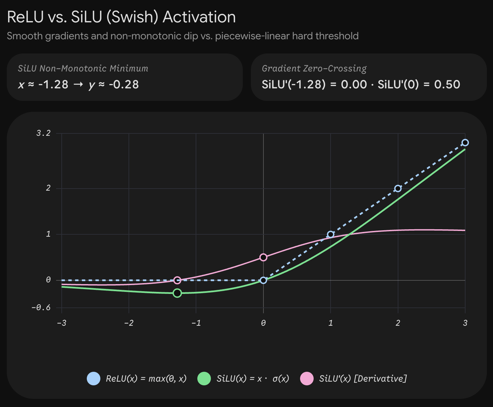

### What Monotonicity Means

A function $f(x)$ is **monotonic** if its output never moves in the opposite direction of its input. If $x_1 \le x_2$, then $f(x_1) \le f(x_2)$ everywhere (non-decreasing). In terms of calculus, its first derivative is always non-negative:

$$
f'(x) \ge 0 \quad \text{for all } x
$$

Classic activation functions are monotonic:

- **ReLU:** $\max(0, x)$ — flat at $0$, then strictly increases with slope $1$.
- **Sigmoid:** $\sigma(x) = \frac{1}{1 + e^{-x}}$ — strictly increases from $0$ toward $1$.
- **Tanh:** strictly increases from $-1$ toward $1$.

A **non-monotonic** activation function violates this rule: its derivative changes sign. As $x$ increases, $f(x)$ may decrease, hit a local minimum, and then increase.

### The Non-Monotonic Behavior in Practice

Modern activation functions like **SiLU / Swish** and **GELU** are non-monotonic:

- **SiLU:** $f(x) = x \cdot \sigma(x) = \frac{x}{1 + e^{-x}}$
- **GELU:** $f(x) = x \cdot \Phi(x) \approx x \cdot \sigma(1.702 x)$
```
f(x)
     ^                                         / (Positive linear regime)
     |                                        /
     |                                       /
     |                                      /
     |                                     /
-----+------------------------------------+--------> x
     | \                                 /  0
     |  \                               /
     |   \                             /
     |    \                           /
     |     ' - . _             _ . - '
     |             \` - - - - \`
     |          (Local Minimum: "The Dip")
```
#### Where the Dip Occurs

Take the derivative of $\text{SiLU}(x) = x \cdot \sigma(x)$:

$$
f'(x) = \sigma(x) + x \cdot \sigma'(x) = \sigma(x) + x \cdot \sigma(x)(1 - \sigma(x)) = \sigma(x)\Big(1 + x(1 - \sigma(x))\Big)
$$

- **For large positive $x$ ($x \to +\infty$):** $\sigma(x) \to 1$, so $f'(x) \to 1$. It acts like ReLU ($f(x) \approx x$).
- **For large negative $x$ ($x \to -\infty$):** $\sigma(x) \to 0$, so $f(x) \to 0$ and $f'(x) \to 0$. Extreme negative inputs are suppressed.
- **Near zero on the negative side ($x \in [-2, 0]$):**
	- At $x = 0$: $f(0) = 0$ and $f'(0) = 0.5 > 0$.
		- At $x = -1$: $\sigma(-1) \approx 0.2689$.
		$f'(-1) = 0.2689 \cdot [1 + (-1)(1 - 0.2689)] = 0.2689 \cdot [1 - 0.7311] = 0.2689 \cdot 0.2689 \approx 0.072 > 0$.
		- Moving further left to $x \approx -1.28$: $f'(x) = 0$. This is the **local minimum**, where $f(-1.28) \approx -0.278$.
		- For $x \in (-\infty, -1.28)$: $f'(x) < 0$. As $x$ becomes more negative, $f(x)$ actually *increases* back toward $0$ from below.

Because the derivative transitions from negative ($x < -1.28$) to zero ($x \approx -1.28$) to positive ($x > -1.28$), the function is **non-monotonic**.

### Why Non-Monotonicity Helps Optimization

For decades, non-monotonicity was avoided because monotonic functions make single-layer optimization problems convex. However, deep networks are fundamentally non-convex, and the non-monotonic "bump/dip" offers three distinct mechanistic advantages:

#### 1\. Soft Thresholding Instead of a Hard Wall

ReLU applies a hard cutoff at zero:

- If $x = -0.001$, output is $0$, gradient is $0$.
- If $x = +0.001$, output is $0.001$, gradient is $1$.

This sharp cliff discards information immediately for any input slightly below zero.

A non-monotonic function like SiLU or GELU treats small negative values differently:

- Mild negative values ($x \in [-1, 0]$) produce a small negative output ($f(x) \in [-0.28, 0]$) with a **non-zero positive gradient**.
- The network can "change its mind": if an incoming signal is slightly negative during early training, it is not immediately silenced. Gradients can still push the weight back into the active positive regime.
- Large negative noise ($x < -3$) is pushed toward zero, maintaining noise suppression.

#### 2\. Negative Gradient Channel

Because $f'(x) < 0$ when $x < -1.28$, backpropagated error gradients flip sign:

$$
\frac{\partial L}{\partial x} = \frac{\partial L}{\partial f} \cdot f'(x)
$$

When $f'(x)$ is negative, an increase in upstream loss pulls the pre-activation $x$ in the opposite direction compared to the positive regime. This introduces a self-stabilizing restorative force that prevents activations from drifting arbitrarily far into the negative regime.

#### 3\. Smoother Loss Landscapes

The non-monotonic dip naturally eliminates the sharp zero-crossing discontinuity ($C^0$ discontinuity in derivative) present in ReLU:



Empirical analysis by Li et al. (2018) on loss landscape visualization showed that replacing ReLU with smooth non-monotonic activations (like GELU or Swish) removes rugged, chaotic terrain full of bad local minima, replacing them with convex-like basins that gradient descent algorithms (AdamW) traverse significantly faster.

### Summary of Monotonic vs. Non-Monotonic

| Feature | Monotonic (e.g., ReLU) | Non-Monotonic (e.g., SiLU, GELU) |
| --- | --- | --- |
| **Derivative Sign** | Strictly $f'(x)\ge 0$ | Can be positive, zero, or negative ($f'(x)\lessgtr 0$) |
| **Negative Input Handling** | Hard truncation to 0 ($x<0\implies \text{grad}=0$) | Curvature dip ($[-0.28,0]$), preserving subtle gradient signals |
| **Loss Landscape** | Piecewise linear, sharp ridges at decision boundaries | Smooth $C^\infty$ or $C^1$ curvature, fewer chaotic local minima |
| **Dead Neurons** | Vulnerable (permanent inactivation) | Self-recovering due to non-zero gradients in the negative dip |
