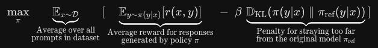

Direct Preference Optimization (DPO) derives an exact, closed-form mapping between the optimal policy in Reinforcement Learning from Human Feedback (RLHF) and the underlying Bradley-Terry reward function.

This formulation eliminates the need to train a separate reward model or use complex actor-critic RL algorithms like Proximal Policy Optimization (PPO).

### 1\. The RLHF Objective in PPO

In standard RLHF, given a frozen reference policy $\pi_{\text{ref}}$ and a learned reward model $r(x, y)$, the policy $\pi_\theta$ is trained to maximize expected reward while penalizing divergence from the base reference model using Kullback-Leibler (KL) divergence:

$$
\max_{\pi} \mathbb{E}_{x \sim \mathcal{D}} \left[ \mathbb{E}_{y \sim \pi(y\vert{}x)} [r(x, y)] - \beta \, \mathbb{D}_{\text{KL}}(\pi(y\vert{}x) \parallel \pi_{\text{ref}}(y\vert{}x)) \right]
$$

Here, $\beta > 0$ controls the strength of the KL penalty to prevent policy drift and reward hacking.

Expanding the expectations and the definition of KL divergence for a single prompt $x$:

$$
\mathcal{L}(\pi) = \sum_{y} \pi(y\vert{}x) \, r(x, y) - \beta \sum_{y} \pi(y\vert{}x) \log \left( \frac{\pi(y\vert{}x)}{\pi_{\text{ref}}(y\vert{}x)} \right)
$$

Factor out $-\beta$:

$$
\mathcal{L}(\pi) = -\beta \sum_{y} \pi(y\vert{}x) \left[ \log \left( \frac{\pi(y\vert{}x)}{\pi_{\text{ref}}(y\vert{}x)} \right) - \frac{1}{\beta} r(x, y) \right]
$$

Combine terms inside the logarithm:

$$
\mathcal{L}(\pi) = -\beta \sum_{y} \pi(y\vert{}x) \log \left( \frac{\pi(y\vert{}x)}{\pi_{\text{ref}}(y\vert{}x) \exp\left( \frac{1}{\beta} r(x, y) \right)} \right)
$$

### 2\. Deriving the Optimal Policy $\pi^*$

Define the partition function (normalizer) $Z(x)$:

$$
Z(x) = \sum_{y} \pi_{\text{ref}}(y\vert{}x) \exp\left( \frac{1}{\beta} r(x, y) \right)
$$

Define a valid probability distribution $\pi^*(y\vert{}x)$:

$$
\pi^*(y\vert{}x) = \frac{1}{Z(x)} \pi_{\text{ref}}(y\vert{}x) \exp\left( \frac{1}{\beta} r(x, y) \right)
$$

Substitute $\pi_{\text{ref}}(y\vert{}x) \exp\left( \frac{1}{\beta} r(x, y) \right) = Z(x) \, \pi^*(y\vert{}x)$ back into the objective:

$$
\mathcal{L}(\pi) = -\beta \sum_{y} \pi(y\vert{}x) \log \left( \frac{\pi(y\vert{}x)}{Z(x) \, \pi^*(y\vert{}x)} \right)
$$

$$
\mathcal{L}(\pi) = -\beta \sum_{y} \pi(y\vert{}x) \left[ \log \left( \frac{\pi(y\vert{}x)}{\pi^*(y\vert{}x)} \right) - \log Z(x) \right]
$$

Because $\sum_y \pi(y\vert{}x) = 1$:

$$
\mathcal{L}(\pi) = -\beta \, \mathbb{D}_{\text{KL}}(\pi(y\vert{}x) \parallel \pi^*(y\vert{}x)) + \beta \log Z(x)
$$

Since $\beta \log Z(x)$ does not depend on $\pi$, the objective is maximized when the KL divergence term is minimized. The minimum of $\mathbb{D}_{\text{KL}}$ is $0$, achieved when:

$$
\pi(y\vert{}x) = \pi^*(y\vert{}x) = \frac{1}{Z(x)} \pi_{\text{ref}}(y\vert{}x) \exp\left( \frac{1}{\beta} r(x, y) \right)
$$

### 3\. Inverting the Policy to Express the Reward

Taking the natural logarithm of both sides of the optimal policy equation:

$$
\log \pi^*(y\vert{}x) = \log \pi_{\text{ref}}(y\vert{}x) + \frac{1}{\beta} r(x, y) - \log Z(x)
$$

Rearranging for the reward $r(x, y)$:

$$
r(x, y) = \beta \log \left( \frac{\pi^*(y\vert{}x)}{\pi_{\text{ref}}(y\vert{}x)} \right) + \beta \log Z(x)
$$

This establishes that any optimal policy implicitly defines a reward function, up to a prompt-dependent constant offset $\beta \log Z(x)$.

### 4\. Substituting into the Bradley-Terry Preference Model

Under the Bradley-Terry (BT) model, the probability that a human annotator prefers response $y_w$ (winning/preferred) over $y_l$ (losing/dispreferred) given prompt $x$ is:

$$
p(y_w \succ y_l \mid x) = \sigma(r(x, y_w) - r(x, y_l))
$$

where $\sigma(z) = \frac{1}{1 + e^{-z}}$ is the sigmoid function.

Substitute the analytical expression for $r(x, y)$ into the difference $r(x, y_w) - r(x, y_l)$:

$$
r(x, y_w) - r(x, y_l) = \left[ \beta \log \left( \frac{\pi^*(y_w\vert{}x)}{\pi_{\text{ref}}(y_w\vert{}x)} \right) + \beta \log Z(x) \right] - \left[ \beta \log \left( \frac{\pi^*(y_l\vert{}x)}{\pi_{\text{ref}}(y_l\vert{}x)} \right) + \beta \log Z(x) \right]
$$

The partition function term $\beta \log Z(x)$ cancels out entirely:

$$
r(x, y_w) - r(x, y_l) = \beta \log \left( \frac{\pi^*(y_w\vert{}x)}{\pi_{\text{ref}}(y_w\vert{}x)} \right) - \beta \log \left( \frac{\pi^*(y_l\vert{}x)}{\pi_{\text{ref}}(y_l\vert{}x)} \right)
$$

Therefore:

$$
p(y_w \succ y_l \mid x) = \sigma \left( \beta \log \frac{\pi^*(y_w\vert{}x)}{\pi_{\text{ref}}(y_w\vert{}x)} - \beta \log \frac{\pi^*(y_l\vert{}x)}{\pi_{\text{ref}}(y_l\vert{}x)} \right)
$$

### 5\. The DPO Loss Function

Parameterized by weights $\theta$ for the policy model $\pi_\theta$, maximum likelihood estimation over the offline dataset of preferences $\mathcal{D} = \{(x, y_w, y_l)\}$ yields the final negative log-likelihood objective:

$$
\mathcal{L}_{\text{DPO}}(\theta; \pi_{\text{ref}}) = -\mathbb{E}_{(x, y_w, y_l) \sim \mathcal{D}} \left[ \log \sigma \left( \beta \log \frac{\pi_\theta(y_w\vert{}x)}{\pi_{\text{ref}}(y_w\vert{}x)} - \beta \log \frac{\pi_\theta(y_l\vert{}x)}{\pi_{\text{ref}}(y_l\vert{}x)} \right) \right]
$$

### Key Differences: PPO vs. DPO

| Feature | RLHF with PPO | Direct Preference Optimization (DPO) |
| --- | --- | --- |
| **Models in Memory** | 4 (Policy, Reference, Reward, Critic) | 2 (Active Policy $\pi_\theta$, Frozen Reference $\pi_{\text{ref}}$) |
| **Optimization Target** | RL on generated rollouts | Supervised classification on static dataset $D$ |
| **Reward Model** | Explicit neural network $r_\phi(x,y)$ | Implicitly represented by $\beta\log(\pi_\theta/\pi_{\text{ref}})$ |
| **Stability** | High variance; sensitive to hyperparameters | Stable cross-entropy-style convex loss |
| **Sampling** | Online text generation during training | Offline batch training on static pairs |
