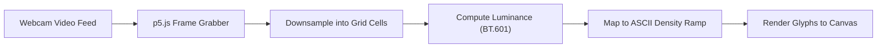

[**View on GitHub**](https://github.com/nagarajpoojari404/ASCII-Art) · [**Live Demo**](https://nagarajrpoojari.github.io/ASCII-Art/) · [**Processing Pipeline**](#how-it-works)

**ASCII Art** is an interactive, browser-based creative coding application that converts live video from a webcam or video stream into dynamically rendered ASCII character graphics in real time at 30+ FPS.

---

## How It Works



### Transformation Algorithm

1. **Frame Capture & Downsampling**:
   - Captures frames from the browser's `navigator.mediaDevices.getUserMedia` video stream.
   - Downsamples the frame into discrete spatial grid cells (e.g. $8 \times 8$ or $12 \times 12$ pixels per character).

2. **Perceptual Luminance Calculation**:
   - Calculates the perceived brightness for each cell using the standard ITU-R BT.601 standard:
     $$\text{Brightness} = 0.299 \cdot R + 0.587 \cdot G + 0.114 \cdot B$$

3. **Glyph Mapping**:
   - Quantizes the calculated brightness value into index bins corresponding to a typography density ramp:
     ```text
     " .'`^",:;Il!i><~+_-?][}{1)(|\/tfjrxnuvczXYUJCLQ0OZmwqpdbkhao*#MW&8%B@$"
     ```

4. **Dynamic Canvas Rendering**:
   - Draws ASCII glyphs with customizable font scaling, background inversion, contrast multipliers, and color tinting.

---

## Live Demo & Usage

- **Live Application**: [https://nagarajrpoojari.github.io/ASCII-Art/](https://nagarajrpoojari.github.io/ASCII-Art/)

### Running Locally

```bash
# Clone the repository
git clone https://github.com/nagarajpoojari404/ASCII-Art.git
cd ASCII-Art

# Open index.html in any modern web browser or serve locally
python3 -m http.server 8000
```
