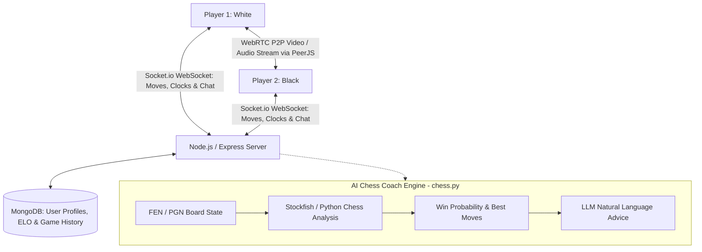

# Real-Time Chess Platform & AI Coach

[**GitHub (Chess Platform)**](https://github.com/nagarajpoojari404/chessProject) · [**GitHub (AI Coach)**](https://github.com/nagarajpoojari404/chess.py)

A modern full-stack real-time multiplayer chess platform enabling players worldwide to compete live while streaming video and audio directly in the browser over peer-to-peer connections. The platform also integrates an interactive AI chess coaching companion (`chess.py`) for move analysis, blunder detection, and positional evaluation.

---

## Real-Time Architecture



---

## Key Features

1. **Low-Latency Move Synchronization**:
   - WebSocket bidirectionality using **Socket.io** guarantees sub-50ms move propagation, clock updates, and spectator broadcasting.
   - Comprehensive move validation, check/checkmate detection, and threefold repetition enforcement.

2. **Integrated Peer-to-Peer Video & Audio**:
   - Direct WebRTC media tracks established via **PeerJS** allow players to see and speak to opponents live without routing high-bandwidth video streams through central servers.

3. **In-Game Chat & Chess Community**:
   - In-game real-time messaging, player ELO rankings, interactive chess puzzles, and community article publishing.

4. **AI Chess Coach (`chess.py`)**:
   - Analyzes game positions in real time to explain tactical motifs (pins, forks, skewers, discovered checks) in plain English.

---

## Tech Stack

- **Frontend**: HTML5, Modern CSS / Bootstrap, Chessboard.js, PeerJS Client
- **Backend**: Node.js, Express.js, Socket.io
- **Real-Time Media**: WebRTC, PeerJS Server
- **Database**: MongoDB & Mongoose
- **AI Coach**: Python, python-chess, Stockfish Engine, LLM evaluations

---

## Running the Platform Locally

```bash
# Clone the web platform repository
git clone https://github.com/nagarajpoojari404/chessProject.git
cd chessProject

# Install dependencies
npm install

# Start the Node.js / Socket.io server
npm start
# Server listens on http://localhost:8000
```
