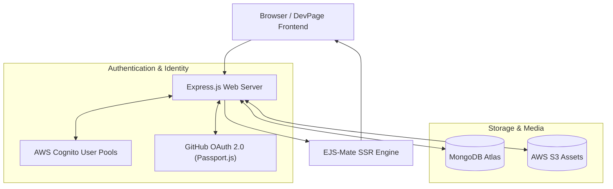

[**View on GitHub**](https://github.com/nagarajpoojari404/DevPage) · [**Architecture**](#full-stack-architecture) · [**Tech Stack**](#tech-stack)

**DevPage** is a dedicated social collaboration and portfolio showcase platform built specifically for software engineers—conceptualized as "Instagram for Developers". Rather than generic images and status updates, DevPage centers around syntax-highlighted code snippets, engineering problem breakdowns, architectural post feeds, and developer showcase profiles.

---

## Full-Stack Architecture



---

## Key Capabilities

1. **Rich Code & Media Sharing**:
   - Create technical posts embedding syntax-highlighted code blocks across 50+ programming languages.
   - Attach system architecture diagrams and flowcharts directly to technical write-ups.

2. **Dual Authentication & Security**:
   - Integrated with **GitHub OAuth 2.0** for one-click developer signup and automatic repository linking.
   - Enterprise-grade user pool management via **AWS Cognito**.

3. **Developer Profile & Portfolio**:
   - Customizable profile showcasing GitHub statistics, featured repositories, technical skill tags, and published articles.

4. **Community Engagement**:
   - Real-time comment threads on code snippets, upvoting, tag filtering, and technical bookmarking.

---

## Tech Stack

| Layer | Technology |
| :--- | :--- |
| **Backend Framework** | Node.js, Express.js |
| **Authentication** | AWS Cognito, Passport.js (`passport-github2`), Express-Session |
| **Database** | MongoDB Atlas, Mongoose ODM |
| **Cloud Storage** | AWS S3 / AWS SDK |
| **Templating / UI** | EJS-Mate, Bootstrap 5, Prism.js (Syntax Highlighting) |

---

## Running Locally

```bash
# Clone the repository
git clone https://github.com/nagarajpoojari404/DevPage.git
cd DevPage

# Install dependencies
npm install

# Configure environment variables (.env)
cp .env.example .env
# Set DB_URL, GITHUB_CLIENT_ID, GITHUB_CLIENT_SECRET, AWS_ACCESS_KEY_ID, AWS_SECRET_ACCESS_KEY

# Start development server with Nodemon
npm start
```
