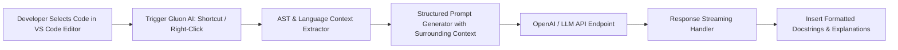

# Gluon AI: Intelligent VS Code Extension

[**View on GitHub**](https://github.com/nagarajpoojari404/Gluon-AI) · [**Features**](#key-capabilities) · [**Architecture**](#how-it-works)

**Gluon AI** is a developer productivity extension for Visual Studio Code designed to eliminate the friction of writing code documentation and reverse-engineering unfamiliar codebases. Powered by GPT models, Gluon AI analyzes selected code snippets, function definitions, or entire modules to generate accurate, formatted docstrings, type annotations, and technical summaries directly inside the IDE.

---

## How It Works



---

## Key Capabilities

1. **One-Click Docstring Generation**:
   - Inspects function signatures, parameter types, return values, and thrown exceptions.
   - Generates standard docstring formats tailored to the active language (JSDoc, Google/NumPy Docstrings in Python, GoDoc, RustDoc).

2. **Context-Aware Code Explanation**:
   - Explains complex algorithms, regular expressions, and convoluted legacy logic in clean, human-readable language.

3. **Refactoring Suggestions & Complexity Analysis**:
   - Identifies time/space complexity bottlenecks, edge-case vulnerabilities, and opportunities for cleaner functional abstractions.

4. **Multi-Language Support**:
   - First-class support for Python, JavaScript/TypeScript, Go, C/C++, Rust, and Java.

---

## Installation & Setup

### From Source

```bash
# Clone the repository
git clone https://github.com/nagarajpoojari404/Gluon-AI.git
cd Gluon-AI

# Install dependencies
npm install

# Compile TypeScript
npm run compile

# Press F5 in VS Code to launch the Extension Development Host
```

### Configuration

Set your OpenAI API key in VS Code Settings:

```json
{
  "gluonAI.apiKey": "sk-...",
  "gluonAI.model": "gpt-3.5-turbo",
  "gluonAI.docstringStyle": "auto"
}
```

### Usage Shortcuts

- **Explain Code**: Select code $\to$ `Ctrl + Shift + P` $\to$ `Gluon AI: Explain Selected Code`
- **Generate Docstrings**: Place cursor above function $\to$ `Ctrl + Shift + P` $\to$ `Gluon AI: Generate Docstring`
