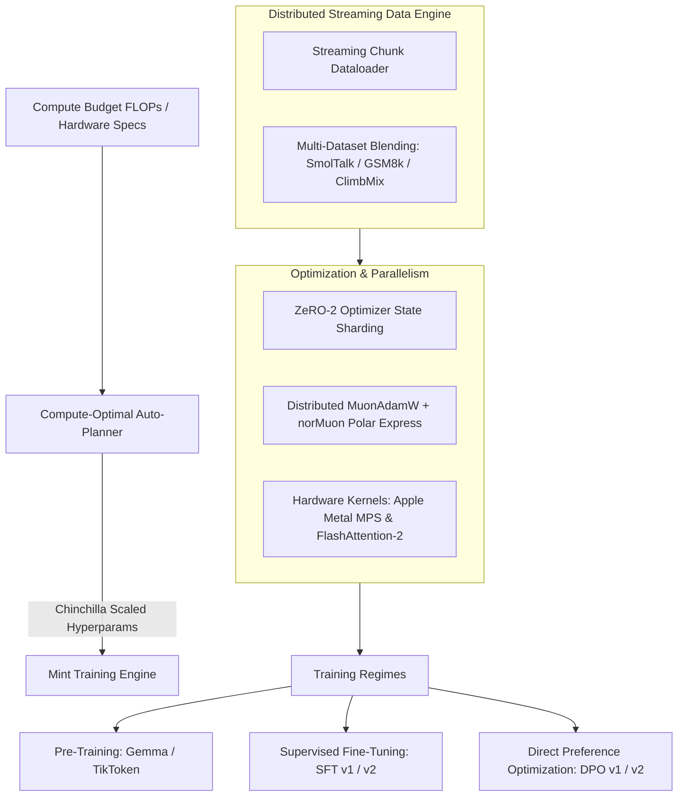

[**View on GitHub**](https://github.com/nagarajpoojari404/mint) · [**Quickstart**](#quickstart--cli-commands) · [**Optimization Features**](#what-makes-mint-special)

**Mint** is a modern, lightweight distributed training, fine-tuning, and alignment framework engineered for Large Language Models. Designed to achieve maximum parameter throughput at lowest hardware cost, Mint runs seamlessly across both Apple Silicon (MPS / Metal) and high-density NVIDIA CUDA GPU clusters.

---

## Architecture & Pipeline



---

## What Makes Mint Special?

### 1. Automated Compute Optimality
Mint automatically calculates scaling-law optimal parameters (dataset token count, layer depth, hidden dimension, and learning rate schedules) based on the user's available FLOP budget and cluster memory constraints.

### 2. Distributed MuonAdamW Optimizer
Integrates the state-of-the-art **Muon** matrix optimizer alongside AdamW, utilizing `norMuon` normalization with Polar Express coefficients for faster convergence on modern transformer architectures.

### 3. ZeRO-2 Sharding & Distributed Dataloaders
- **ZeRO-2 Sharding**: Partitions optimizer states and gradients across available ranks to enable training larger models on memory-constrained GPUs.
- **Custom Streaming Dataloaders**: Streams pre-tokenized shards directly from disk or cloud buckets without memory bloat.

### 4. Cross-Platform Acceleration
- **Apple Silicon (MPS)**: Native Metal Performance Shaders integration for local M-series Mac fine-tuning.
- **NVIDIA CUDA**: Supports PyTorch Distributed Data Parallel (DDP), FlashAttention-2, and `bfloat16` mixed precision.

---

## Quickstart & CLI Commands

### Installation

```bash
# Clone and install Mint
git clone https://github.com/nagarajpoojari404/mint.git
cd mint
uv pip install -e .
```

### Pre-Training

```bash
# Pre-train a custom transformer model
uv run mint pretrain --config configs/config_d12_pretrain.toml

# Stream training across sharded datasets
uv run mint stream-train \
    --num-train-shards 4 \
    --min-shards 1 \
    --train-script scripts/pretrain.py \
    --train-args "--config configs/config_d12_pretrain.toml"
```

### Supervised Fine-Tuning (SFT)

```bash
# SFT on custom architectures
uv run mint sft --config configs/config_d12_sft.toml

# SFT on HuggingFace models (e.g. Qwen2, Llama) with curated datasets
uv run mint v2-sft \
    --config configs/config_hf_sft.toml \
    --model-name Qwen/Qwen2-0.5B \
    --datasets gsm8k smoltalk
```

### Direct Preference Optimization (DPO)

```bash
# DPO alignment against a reference model
uv run mint dpo \
    --config configs/config_d12_dpo.toml \
    --ref-model checkpoints/checkpoint_step_10.pt

# HuggingFace DPO
uv run mint v2-dpo \
    --model-name Qwen/Qwen2-0.5B \
    --config configs/config_hf_dpo.toml
```

---

## Dataset Utilities Included

- `mint prepare-dpo`: Prepares preference pairs (chosen vs. rejected responses).
- `mint download-climbmix`: Downloads and tokenizes curated reasoning and code pre-training datasets.
