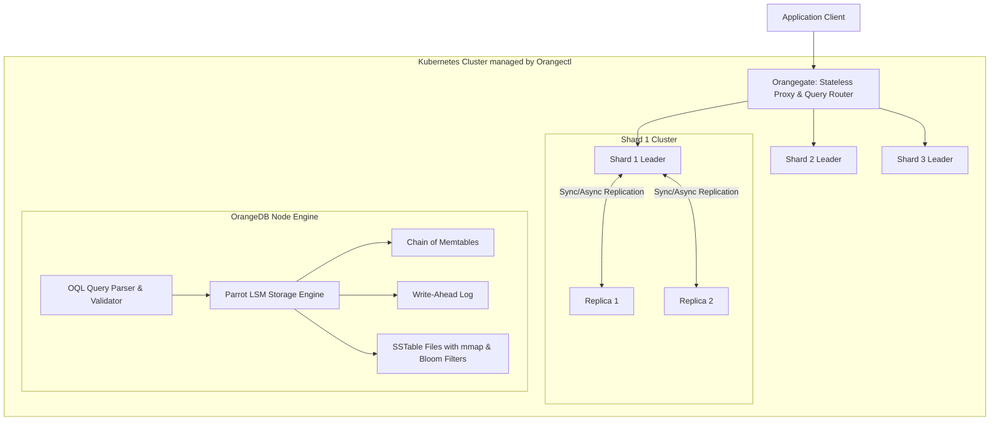

# OrangeDB: Distributed NoSQL Database

[**GitHub (Orange)**](https://github.com/nagarajpoojari404/orange) · [**GitHub (Parrot)**](https://github.com/nagarajpoojari404/parrot) · [**GitHub (Orangectl)**](https://github.com/nagarajpoojari404/orangectl) · [**Architecture Post**](/posts/orange/)

**OrangeDB** is a lightweight, distributed, cloud-native NoSQL key-document database written in Go. It blends architectural concepts from systems like Cassandra, MongoDB, RocksDB, LevelDB, and CockroachDB to achieve high write throughput, predictable low-latency reads, and horizontal scalability across Kubernetes clusters.

---

## The Orange Ecosystem



### Components

1. **OrangeDB Core**: The database server handling primary-key indexing, native binary document serialization, schema validation, and SQL-like querying via **OQL** (Orange Query Language).
2. **Parrot Storage Engine**: An embedded Log-Structured Merge (LSM) tree engine built for maximum I/O concurrency and write performance.
3. **Orangegate**: A high-performance stateless proxy placed in front of the cluster to route read/write queries to the correct partition owners and perform quorum aggregation.
4. **Orangectl**: A custom Kubernetes Operator providing CRDs to automate cluster provisioning, autoscaling, master failover, and data rebalancing.

---

## Parrot LSM Storage Engine Innovations

Traditional B-Trees suffer from write amplification because updating records incurs random disk writes across multiple tree levels. LSM trees write sequentially to an append-only log, dramatically accelerating write operations.

Parrot introduces key architectural enhancements over conventional LSM engines:

### 1. Chain of Memtables (Uninterrupted Writes)
Standard double-buffered LSM trees pause incoming writes when both active and flushing memtables become full. Parrot employs a **queue/chain of memtables**:
- Ingestion continuously appends new immutable memtables to the queue.
- Background flush workers consume independently from the tail, eliminating write stalls under bursty workloads.

### 2. Zero-Copy `mmap` Reads
Parrot reads on-disk SSTable blocks via shared memory mapping (`mmap`). Operating system page caches are accessed directly without copying block payloads into user-space buffers, minimizing CPU cache misses and memory churn.

### 3. Optimistic Concurrency Control (OCC)
Minimizes lock contention across concurrent read/write transactions by leveraging lock-free atomic pointers for memtable switching and versioned SSTable manifest tracking.

---

## Feature Matrix

- **Document Model**: JSON-like schema-free or strict schema-validated document storage.
- **Native Binary Encoding**: Efficient serialization reducing network payloads and disk space.
- **Crash Recovery**: Append-only Write-Ahead Logging (WAL) ensures ACID durability.
- **Compaction**: Multi-level background compaction removes stale tombstones and deduplicates updated records.
- **High Availability**: Configurable Quorum reads ($R + W > N$) and synchronous/asynchronous replica synchronization.
- **Kubernetes Native**: Automated deployment and lifecycle management via CRDs and Helm charts.

---

## Quickstart & Installation

### Standalone Installation

```bash
# Install Orange CLI / server
go install github.com/nagarajpoojari404/orange@latest

# Start OrangeDB standalone server
orange start --port 8080 --data-dir ./orange-data
```

### Cluster Deployment via Kubernetes (`orangectl`)

```bash
# Install Orangectl Custom Resource Definitions (CRDs)
kubectl apply -f https://raw.githubusercontent.com/nagarajpoojari404/orangectl/main/dist/install.yaml

# Deploy an OrangeDB 3-node sharded cluster
kubectl apply -f https://raw.githubusercontent.com/nagarajpoojari404/orangectl/main/config/samples/cluster_v1_orange.yaml
```

### Load Testing with k6

```bash
k6 run k6/stress_test.js
k6 run k6/load_test.js
```
