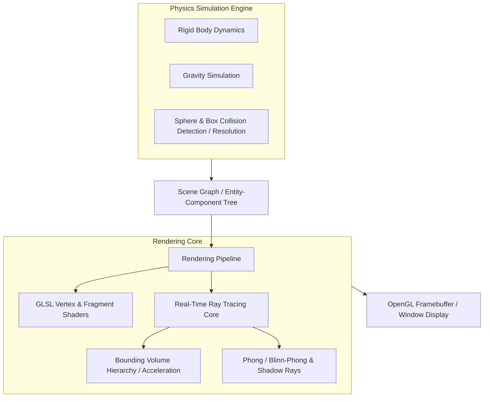

[**View on GitHub**](https://github.com/nagarajpoojari404/owl) · [**Features**](#key-features) · [**Building & Running**](#building--running)

**Owl** is a high-level 3D graphics and real-time rendering engine written from scratch using C++, modern OpenGL, and GLSL shaders. Built to explore low-level rendering pipelines, ray-object intersection mathematics, lighting models, and physics simulations, Owl delivers real-time ray tracing alongside interactive 3D scene manipulation.

---

## Architectural Overview



---

## Key Features

### 1. Real-Time Ray Tracing
- Implements ray generation from virtual camera perspective through screen pixels.
- Exact analytical ray-primitive intersection tests for spheres, planes, triangles, and bounding boxes.
- Recursive reflection and refraction calculations for dielectric and metallic surfaces.
- Soft shadow generation and ambient occlusion approximations.

### 2. Physics Simulation Engine
- Integrated rigid-body kinematics with constant gravitational acceleration.
- Elastic and inelastic impulse-based collision response between dynamic objects.
- Continuous spatial partitioning to accelerate multi-body collision queries.

### 3. Shader Pipeline & Materials
- Custom GLSL vertex, fragment, and compute shaders.
- Support for diffuse, specular, normal mapping, and reflection maps.
- Configurable point lights, directional lights, and ambient illumination.

### 4. Interactive Camera & Controls
- First-person 6-DOF (degree-of-freedom) Euler angle camera controller.
- Smooth mouse look and keyboard navigation across 3D scenes.

---

## Building & Running

### Prerequisites

- C++17 or higher
- CMake / Make
- OpenGL 3.3+ Core Profile
- GLFW / GLEW / GLM

```bash
# Clone the repository
git clone https://github.com/nagarajpoojari404/owl.git
cd owl

# Compile the engine
make build

# Run the 3D engine demo
./bin/owl_engine
```
