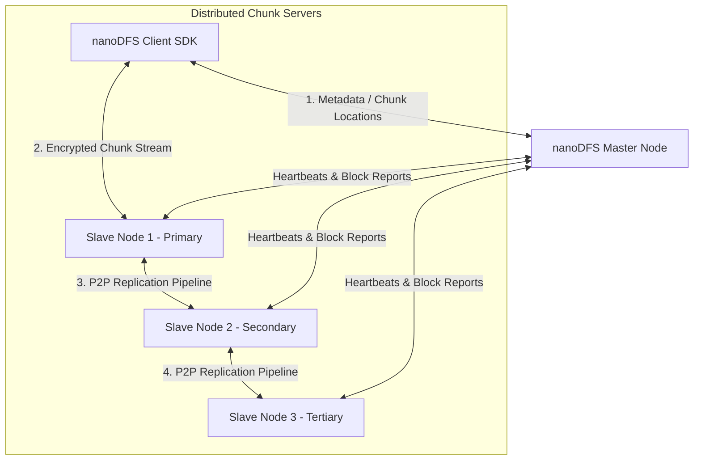

# PandaFS (nanoDFS): Distributed File System

[**GitHub Organization (nanoDFS)**](https://github.com/nanoDFS) · [**Master Node**](https://github.com/nanoDFS/Master) · [**Slave (Chunk Server)**](https://github.com/nanoDFS/Slave) · [**Go Client SDK**](https://github.com/nanoDFS/client-sdk) · [**P2P Library**](https://github.com/nanoDFS/p2p)

**PandaFS** (developed under the `nanoDFS` organization) is a fault-tolerant, scalable, distributed file system modeled after the Google File System (GFS) architecture. Written in Go, it is engineered for high-bandwidth streaming reads and writes over large datasets across clusters of commodity hardware.

---

## Architectural Topology



### Core Architecture Components

1. **Master Node (`nanoDFS/Master`)**:
   - Manages the entire filesystem namespace, access control lists (ACL), and file-to-chunk mappings.
   - Monitors chunk server health through periodic heartbeats and initiates automated re-replication upon node failure.
   - Never sits in the direct data transfer path, preventing bottlenecking on high-volume reads and writes.

2. **Slave / Chunk Servers (`nanoDFS/Slave`)**:
   - Stores 64MB fixed-size file chunks directly on local storage.
   - Computes checksums per chunk to identify silent bit rot and data corruption.
   - Executes peer-to-peer chunk replication pipelines across secondary replicas.

3. **P2P Transport Protocol (`nanoDFS/p2p`)**:
   - Custom low-level networking library maintaining persistent, bidirectional TCP connections between peer storage nodes.

4. **Security & Cryptography**:
   - **Client-Side Encryption**: Files are encrypted with symmetric keys (e.g. AES-256) on the client before being streamed to chunk servers.
   - **Token-Based Access Control**: Master issues time-bound cryptographic tokens for authorized chunk reads and writes.

---

## Client SDK Quickstart (Go)

Install the SDK:

```bash
go get github.com/nanoDFS/client-sdk
```

Upload and download files securely:

```go
package main

import (
    "fmt"
    "log"

    "github.com/nanoDFS/client-sdk/crypto"
    "github.com/nanoDFS/client-sdk/fs"
)

func main() {
    // Generate or load client encryption key
    cryptoKey := crypto.DefaultCryptoKey()
    client := fs.NewFileSystem()

    // Upload a file to PandaFS (automatically chunked, encrypted, and replicated)
    fileID, userID, err := client.Upload(cryptoKey, "./dataset.tar.gz")
    if err != nil {
        log.Fatalf("Failed to upload file: %v", err)
    }
    fmt.Printf("Uploaded successfully! FileID: %s, UserID: %s\n", fileID, userID)

    // Download and decrypt the file
    err = client.Download(fileID, userID, cryptoKey, "./downloads/dataset_restored.tar.gz")
    if err != nil {
        log.Fatalf("Failed to download file: %v", err)
    }
    fmt.Println("File downloaded and verified successfully!")
}
```

---

## Key Capabilities

- **Automatic Fault Recovery**: Degraded chunks are automatically detected and restored to maintain replication invariants.
- **Append-Focused Streaming**: Optimized for large sequential writes and concurrent reader streams.
- **Zero Metadata Contention**: Chunk servers independently manage physical I/O without querying the Master on each read operation.
