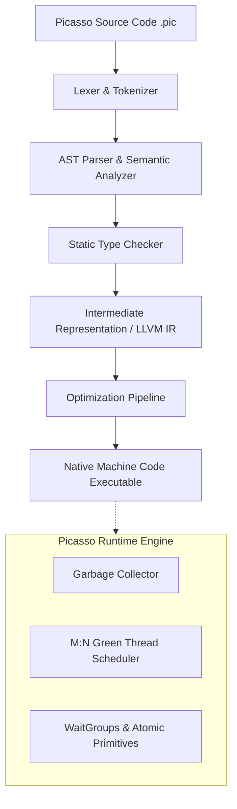

[**View on GitHub**](https://github.com/nagarajpoojari404/picasso-lang) · [**Quickstart**](#installation--usage) · [**Syntax Guide**](#language-syntax--features)

**Picasso** is a modern, statically typed compiled systems programming language designed from first principles. It combines the raw performance and predictable resource utilization of native compiled code with the developer ergonomics, safety, and conciseness of modern high-level languages.

Picasso eliminates traditional systems programming friction through built-in lightweight green threads, automatic garbage collection, rich synchronization primitives, and zero-cost abstractions.

---

## Architectural Highlights



### Key Features

- **Direct Native Compilation**: Compiles directly to native machine code without virtual machine overhead or JIT warm-up latency.
- **Procedural with First-Class Object Support**: Combines structured procedural programming with clean object-oriented class definitions and methods.
- **Expressive Static Type System**:
  - Signed & unsigned sized integers: `int8` through `int64`, `uint8` through `uint64`
  - Floating point numbers: `float` (32-bit), `double` (64-bit)
  - Primitive strings, booleans, and dynamically resizable arrays
  - Atomic primitives for thread-safe lock-free operations
  - User-defined composite classes and structures
- **Built-in M:N Concurrency (Green Threads)**:
  - Spawn lightweight green threads effortlessly with `thread(fn, args...)`
  - No cumbersome `async/await` syntax coloring or promise chaining
  - Capable of scaling to hundreds of thousands of concurrent tasks with minimal stack footprint
- **Non-Preemptive Blocks & Synchronization**:
  - Critical atomic regions via non-preemptive code blocks `(* ... *)`
  - Built-in `WaitGroup` primitives for coordinating parallel workflows
- **Automatic Garbage Collection**: High-throughput memory management—allocate dynamically without manual memory freeing or fear of memory leaks.

---

## Language Syntax & Features

### 1. Variables & Primitive Types

```c
// Variable declarations
int32 age = 25;
double pi = 3.1415926535;
string greeting = "Hello, Picasso!";
bool isActive = true;

// Dynamic arrays
int32[] numbers = [1, 2, 3, 4, 5];
numbers.append(6);
```

### 2. Classes and Object Orientation

```c
class Vector2D {
    public double x;
    public double y;

    public void init(double x, double y) {
        this.x = x;
        this.y = y;
    }

    public double magnitude() {
        return sqrt(this.x * this.x + this.y * this.y);
    }
}

Vector2D v = new Vector2D();
v.init(3.0, 4.0);
println("Magnitude: ", v.magnitude()); // 5.0
```

### 3. Lightweight Concurrency & Synchronization

```c
void worker(int32 id, WaitGroup wg) {
    println("Worker ", id, " starting computation...");
    
    // Critical section executed without preemption
    (*
        println("Worker ", id, " inside atomic region");
    *)
    
    wg.done();
}

void main() {
    WaitGroup wg = new WaitGroup();
    int32 numWorkers = 8;
    
    wg.add(numWorkers);
    
    for (int32 i = 0; i < numWorkers; i = i + 1) {
        thread(worker, i, wg);
    }
    
    wg.wait();
    println("All concurrent workers completed successfully!");
}
```

---

## Installation & Usage

### Building from Source

```bash
# Clone the repository
git clone https://github.com/nagarajpoojari404/picasso-lang.git
cd picasso-lang

# Build the compiler
make build

# Run tests
make test
```

### Compiling & Running Programs

```bash
# Compile a Picasso source file to a native binary
./picasso build main.pic -o my_app

# Execute the binary
./my_app
```

---

## Project Status & Roadmap

- [x] Lexical analysis & AST generation
- [x] Static type checking and symbol resolution
- [x] Native code generation
- [x] Garbage collection integration
- [x] Lightweight green thread scheduler & waitgroups
- [ ] Self-hosting compiler
- [ ] Standard library expansion (HTTP, Cryptography, JSON serialization)
