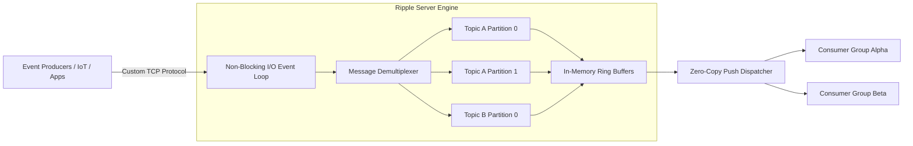

# Ripple MQ: Distributed Event Streaming System

[**GitHub (Server)**](https://github.com/ripple-mq/ripple-server) · [**GitHub (Go Client)**](https://github.com/ripple-mq/go-client) · [**GitHub (Benchmark)**](https://github.com/ripple-mq/benchmark)

**Ripple MQ** is a high-throughput, ultra-low latency distributed in-memory event streaming engine written in Go. Designed for large-scale telemetry ingestion, real-time message broadcasting, and event-driven microservice architectures, Ripple combines a single-threaded non-blocking I/O event loop with lock-free memory buffers to achieve high message rates while keeping CPU overhead minimal.

---

## Architecture & Design



### Core Innovations

- **Single-Threaded Non-Blocking I/O**: Eliminates thread context-switching overhead and multi-threaded mutex lock contention on the hot path by processing network frames sequentially on an optimized event loop.
- **In-Memory Ring Buffers**: Employs circular memory structures with zero-copy slice slicing for message ingestion and fan-out consumption.
- **Custom Wire Protocol**: Lightweight binary framing over raw TCP avoids the heavy serialization overhead and HTTP/2 framing tax associated with gRPC and REST.
- **Partitioned Topic Queues**: Supports horizontal stream partitioning to allow parallel consumption across independent consumer worker pools.

---

## Ecosystem Components

1. **`ripple-server`**: The core messaging engine handling client connections, partition management, and message dispatch.
2. **`go-client`**: An ergonomic, production-grade Go SDK for producing and consuming message streams with automatic connection pooling and reconnect handling.
3. **`benchmark`**: A high-concurrency performance benchmarking and stress-testing tool evaluating throughput, p99 latency, and saturation points against Apache Kafka and RabbitMQ.

---

## Client SDK Usage (Go)

```go
package main

import (
    "context"
    "fmt"
    "log"

    "github.com/ripple-mq/go-client"
)

func main() {
    // Initialize Ripple client connection
    client, err := ripple.NewClient(ripple.Config{
        Addr: "127.0.0.1:9092",
    })
    if err != nil {
        log.Fatalf("Failed to connect to Ripple MQ: %v", err)
    }
    defer client.Close()

    // Publish an event to topic 'orders'
    err = client.Publish(context.Background(), "orders", []byte(`{"order_id": "1001", "amount": 49.99}`))
    if err != nil {
        log.Fatalf("Publish failed: %v", err)
    }
    fmt.Println("Event published successfully!")

    // Subscribe and consume events
    sub, err := client.Subscribe(context.Background(), "orders", "analytics-consumer-group")
    if err != nil {
        log.Fatalf("Subscription failed: %v", err)
    }

    for msg := range sub.Messages() {
        fmt.Printf("Received message: %s\n", string(msg.Payload))
        msg.Ack()
    }
}
```

---

## Benchmarking & Local Setup

```bash
# Clone the server repository
git clone https://github.com/ripple-mq/ripple-server.git
cd ripple-server

# Install dependencies and build
make install
make build

# Start Ripple server
./bin/ripple-server --config config.yaml

# Run benchmarks
git clone https://github.com/ripple-mq/benchmark.git
cd benchmark && go run main.go --target 127.0.0.1:9092 --concurrency 50 --messages 1000000
```
