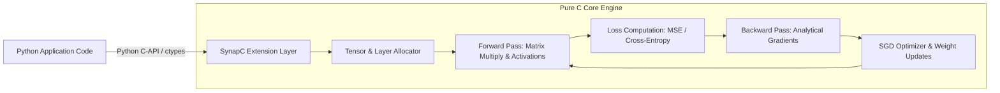

[**View on GitHub**](https://github.com/nagarajpoojari404/SynapC) · [**PyPI Package**](https://pypi.org/project/synapc/) · [**Python Quickstart**](#python-quickstart)

**SynapC** is a minimalist, dependency-free neural network library implemented entirely in pure C from scratch, featuring native Python C-extension bindings. It provides a transparent, low-overhead way to understand and execute feedforward neural networks (FFNN) and gradient-based backpropagation without relying on massive framework runtimes.

---

## Architectural Workflow



---

## Key Features

- **Pure C Engine**: Implemented from scratch using standard C runtime without external dependencies (no BLAS/LAPACK required).
- **Python C-Extension**: Seamless Python API (`pip install synapc`) exposing fast compiled C execution to Python workflows.
- **Customizable Topologies**: Arbitrary multi-layer feedforward neural networks with configurable layer dimensions.
- **Activation Functions**: Built-in support for Sigmoid, ReLU, Tanh, and Softmax activations.
- **Backpropagation**: Fully analytical gradient calculation and Stochastic Gradient Descent (SGD) weight updates.

---

## Python Quickstart

### Installation

```bash
pip install synapc==0.0.5
```

### Building & Training a Model in Python

```python
import synapc
import numpy as np

# Sample training data (XOR problem)
X_train = np.array([
    [0, 0],
    [0, 1],
    [1, 0],
    [1, 1]
], dtype=np.float32)

y_train = np.array([
    [0],
    [1],
    [1],
    [0]
], dtype=np.float32)

# 1. Initialize network with input dimension = 2
model = synapc.init(2)

# 2. Add hidden layers (dense layers)
synapc.add(model, 4) # Hidden layer 1: 4 neurons
synapc.add(model, 4) # Hidden layer 2: 4 neurons
synapc.add(model, 1) # Output layer: 1 neuron

# 3. Compile model with training parameters
synapc.compile(model, learning_rate=0.1)

# 4. Train model over epochs
synapc.train(model, X_train, y_train, epochs=2000)

# 5. Perform inference
predictions = synapc.predict(model, X_train)
print("Inference Predictions:", predictions)
```

---

## C API Usage (Pure C Native Code)

```c
#include "synapc.h"
#include <stdio.h>

int main() {
    // Create network architecture
    NeuralNet* net = synapc_create_network(2);
    synapc_add_layer(net, 4, ACTIVATION_RELU);
    synapc_add_layer(net, 1, ACTIVATION_SIGMOID);

    // Forward pass
    float input[2] = {1.0f, 0.0f};
    float output[1];
    synapc_forward(net, input, output);

    printf("Output: %f\n", output[0]);

    synapc_free_network(net);
    return 0;
}
```
