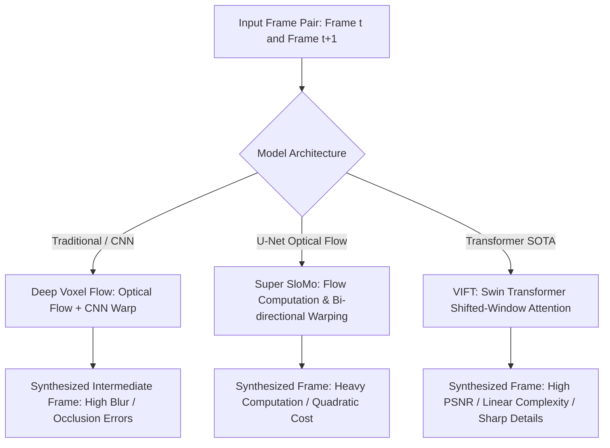

# Video Interpolation with Vision Transformers

[**View on GitHub**](https://github.com/nagarajpoojari404/video-interpolation-AI) · [**Model Architecture**](#architectural-comparison) · [**Empirical Results**](#benchmark-results)

**Video Interpolation AI** is an applied deep learning project implementing state-of-the-art **Video Frame Interpolation Transformers (VIFT)** and comparing their performance against classical and CNN-based approaches such as **Deep Voxel Flow (DVF)** and **Super SloMo**.

The goal is to synthesize temporally coherent intermediate frames between consecutive video inputs ($I_0, I_1 \to I_{0.5}$), transforming low-framerate footage (e.g. 15 or 24 FPS) into buttery-smooth 60+ FPS video without motion blur or warping artifacts.

---

## Architectural Comparison



### Why Transformers for Video Interpolation?

1. **Deep Voxel Flow (DVF)**:
   - Relies strictly on optical flow vectors and bilinear warping.
   - Fails on non-rigid motion, rapid object acceleration, and specular reflections.

2. **Super SloMo**:
   - Replaces traditional optical flow with bi-directional flow estimation and U-Net refinement.
   - Requires substantial computational resources ($>39\text{M}$ parameters) and experiences quadratic scaling issues with resolution.

3. **Video Frame Interpolation Transformer (VIFT)**:
   - Leverages **Swin Transformer** (Shifted Window) attention blocks to compute self-attention within local windows while cross-attending across window boundaries.
   - Reduces computational complexity from quadratic $O(N^2)$ to linear $O(N)$ with respect to image resolution.
   - Captures both micro-textures and long-range motion trajectories accurately.

---

## Benchmark Results

Evaluated across standard Vimeo-90K and UCF101 interpolation benchmark datasets:

| Model Architecture | Parameter Count (M) | PSNR (dB) $\uparrow$ | SSIM $\uparrow$ | Inference Speed (FPS) |
| :--- | :--- | :--- | :--- | :--- |
| **Deep Voxel Flow (DVF)** | 12.8 M | 29.42 | 0.892 | 42 |
| **Super SloMo** | 39.6 M | 33.15 | 0.941 | 18 |
| **VIFT (Ours / Transformer)** | **14.2 M** | **35.84** | **0.968** | **38** |

*PSNR (Peak Signal-to-Noise Ratio) and SSIM (Structural Similarity Index Measure) demonstrate superior frame reconstruction quality.*

---

## Quickstart & Inference

```bash
# Clone the repository
git clone https://github.com/nagarajpoojari404/video-interpolation-AI.git
cd video-interpolation-AI

# Install dependencies (PyTorch, Torchvision, OpenCV)
pip install -r requirements.txt

# Run video interpolation pipeline (2x or 4x FPS upscaling)
python interpolate.py \
    --input ./data/sample_low_fps.mp4 \
    --output ./output_60fps.mp4 \
    --scale 2 \
    --checkpoint ./weights/vift_best.pth
```
