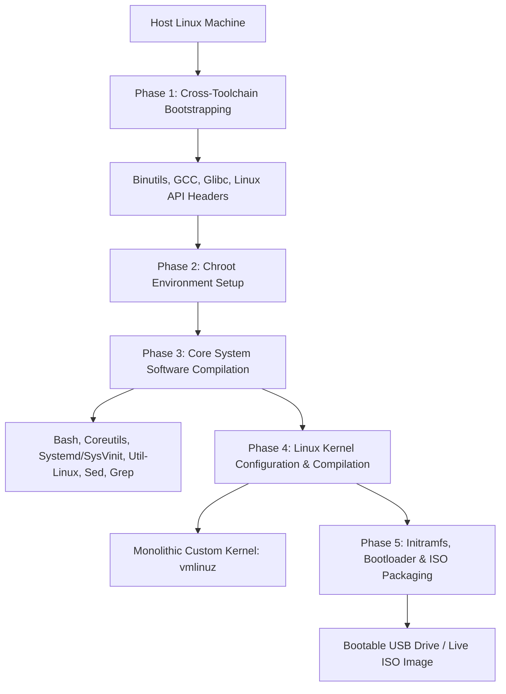

[**View on GitHub**](https://github.com/nagarajpoojari404/x-Linux) · [**Build Pipeline**](#the-build-pipeline) · [**Quickstart**](#building-and-booting)

**x-Linux** is an independent, custom Linux distribution and automated build orchestration pipeline designed following the **Linux From Scratch (LFS)** methodology. It demonstrates how to bootstrap a minimal, self-contained, POSIX-compliant operating system directly from upstream source packages without relying on third-party precompiled binaries.

---

## The Build Pipeline



---

## Key System Components

1. **Toolchain Bootstrapping**:
   - Compiles a sanitized host-independent cross-compiler (`binutils`, `gcc`, `glibc`).
   - Isolates the build process using `chroot` to ensure zero host-system contamination.

2. **Core Utilities & Shell**:
   - Builds standard GNU userland tools (`bash`, `coreutils`, `findutils`, `grep`, `sed`, `tar`, `gzip`, `kmod`).
   - Configures user authentication, PAM, and basic networking utilities (`iproute2`).

3. **Linux Kernel Customization**:
   - Tailored monolithic kernel configuration stripped of unneeded drivers for ultra-fast boot times.
   - Built-in ext4/FAT32 filesystem drivers, USB mass storage support, and EFI stub loader.

4. **Bootloader & Storage Layout**:
   - GRUB2 bootloader installation supporting both legacy BIOS (MBR) and modern UEFI (GPT) boot modes.
   - Bootable ISO generator for live testing in QEMU, VirtualBox, or physical bare-metal hardware.

---

## Building and Booting

### Requirements

- A Linux host machine (Debian/Ubuntu, Arch, or Fedora)
- Minimum 16 GB free disk space
- Root/sudo privileges for mount and chroot operations
- QEMU (optional, for virtual machine testing)

### Automated Build Script

```bash
# Clone the build scripts
git clone https://github.com/nagarajpoojari404/x-Linux.git
cd x-Linux

# Run the complete build and packaging pipeline
chmod +x build.sh
sudo ./build.sh
```

### Testing with QEMU

```bash
# Boot the freshly generated x-Linux ISO inside QEMU
qemu-system-x86_64 -cdrom xlinux.iso -m 2048M -enable-kvm
```
